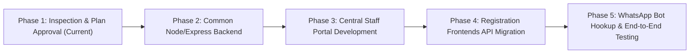

# Phase 1: Existing Application Code Inspection & Implementation Plan
**Project:** Kairos WhatsApp Learning System  
**Document Version:** 1.0  
**Inspection Date:** November 2026  
**Status:** Awaiting User Review & Approval (No code modified)

---

## 1. Executive Summary

This inspection covers the complete existing codebase of the **Kairos WhatsApp Learning** ecosystem across all active workspaces:
1. `whatsapp-Kairos (final)`: WhatsApp Conversational Chatbot & DRM Classroom Backend.
2. `Reg_Sprout_english1\Reg_Sprout_english`: English Student Registration Application with embedded Staff Dashboards.
3. `Reg_Sprout_French1\Reg_Sprout_French`: French Student Registration Application with embedded Staff Dashboards.
4. `Kairos_Database_Handover`: PostgreSQL Database DDL schemas, table structures, and AWS RDS environment templates.

### Primary Architectural Findings:
* **UI Duplication:** The Payment Dashboard (`PaymentStaff.jsx`), Report Dashboard (`ReportStaff.jsx`), Staff Login (`Login.jsx`), Authentication Context (`AuthContext.jsx`), Protected Route (`ProtectedRoute.jsx`), and setup scripts are **100% byte-for-byte identical** between the English and French registration repositories.
* **Data Siloing:** Because English and French use separate Firebase projects (`reg-fe-and-sme-sprout` and `reg-feandsme-sprout`), staff currently have to log into two different applications to see student records for each language.
* **Client-Direct Firebase:** The registration apps currently have **no backend API**; they write directly from the React client to Firebase Firestore using the Firebase Web SDK.
* **Database Readiness:** AWS RDS PostgreSQL (`devdb`, `public` schema) already contains the complete relational schema with 4 operational tables: `wa_courses`, `wa_registrations`, `wa_payments`, and `wa_enrollments`.

---

## 2. Detailed Codebase Inspection (Items 1 - 9)

### Item 1: WhatsApp Bot Folder and Technology
* **Exact Folder Path:**
  * Root wrapper: `whatsapp-Kairos (final)`
  * Core backend source: `whatsapp-Kairos (final)\whatsapp-Kairos\whatsapp-new\backend`
* **Entry Point:**
  * `whatsapp-Kairos (final)\package.json` (`"main": "whatsapp-Kairos/whatsapp-new/backend/server.js"`)
  * `whatsapp-Kairos (final)\whatsapp-Kairos\whatsapp-new\backend\server.js`
* **Technology Stack:**
  * **Runtime & Framework:** Node.js (CommonJS) + Express (`^4.21.2`)
  * **HTTP Client:** Axios (`^1.7.9`)
  * **Environment Config:** Dotenv (`^16.4.7`)
  * **WhatsApp API:** Meta WhatsApp Cloud API v26.0 (interactive CTA buttons, quick replies, webhook ingestion)
  * **DRM Classroom Web Player:** Custom HTML5 canvas player (`backend\public\player.html`) with dynamic floating watermarking (student name + phone), anti-screen recording, developer-tool tamper prevention, HMAC-SHA256 session tokenization (`crypto`), and HTTP 206 Partial Content video streaming.
  * **Current Data Storage:**
    * Google Sheets CRM (`services\googleSheetService.js` via Google Apps Script web app `GOOGLE_SHEET_SCRIPT_URL`).
    * Local JSON file storage in `backend\data\` (`students.json`, `leads.json`, `drm_sessions.json`, `conversations.json`, `processed_messages.json`).
* **Existing Bot Endpoints:**
  * `GET /webhook` & `POST /webhook`: Meta WhatsApp Cloud API verification and message handler.
  * `POST /api/webhook/student-registered`: Ingests registered students and sends instant WhatsApp welcome message.
  * `POST /api/webhook/payment-confirmed`: Unlocks classroom session and sends interactive button on WhatsApp.
  * `GET /classroom/:sessionId`: Serves the DRM protected web classroom.
  * `POST /api/classroom/handshake`: Device fingerprint binding and token generation.
  * `GET /api/video/stream/:token`: DRM chunked video stream.
  * `GET /health` & `GET /`: Cloud health check & keep-alive background ping.

---

### Item 2: English Registration Source Code and Folder
* **Exact Folder Path:**
  * Wrapper folder: `Reg_Sprout_english1`
  * Application folder: `Reg_Sprout_english1\Reg_Sprout_english`
* **Technology Stack:**
  * React 19 (`react: ^19.2.8`, `react-dom: ^19.2.8`)
  * Build Tool: Vite 8 (`vite: ^8.3.0`, `@vitejs/plugin-react: ^6.1.1`)
  * Routing: React Router DOM v7 (`react-router-dom: ^7.18.4`)
  * UI Framework: Bootstrap 5 (`bootstrap: ^5.3.8`) & FontAwesome 7 (`@fortawesome/fontawesome-free: ^7.3.1`)
  * Cloud / BaaS: Firebase Web SDK v12 (`firebase: ^12.19.0`) - Auth & Firestore
  * Analytics & Charting: Chart.js (`chart.js: ^4.5.1`, `react-chartjs-2: ^5.3.1`, `chartjs-plugin-datalabels: ^2.2.0`)
  * Data Export: SheetJS (`xlsx: ^0.18.5`)
* **Key Files:**
  * `index.html`: Application HTML entry.
  * `src/main.jsx`: React root mount with `BrowserRouter`.
  * `src/App.jsx`: Main routing container (`/registration`, `/thank-you`, `/login`, `/paymentstaff`, `/reportstaff`, `/unauthorized`).
  * `src/pages/Registration.jsx`: Public registration page setting `lang = 'en'`.
  * `src/components/RegistrationForm.jsx`: Public registration form with African country dial codes.
  * `src/pages/ThankYou.jsx`: Confirmation page showing QR code and next steps.
  * `src/utils/i18n.js`: Bilingual localization dictionary for `en` and `fr`.
  * `src/utils/validation.js`: Input validation for name, phone, email, city, occupation.
  * `src/utils/africanCountries.js`: Country codes and dial prefixes.
  * `src/firebase/firebaseConfig.js`: Firebase client initialization for project `reg-fe-and-sme-sprout`.
  * `src/firebase/registrationService.js`: Direct Firestore insert into collection `registrations`.
  * `.env` & `.firebaserc`: Firebase project credentials (`reg-fe-and-sme-sprout`).

---

### Item 3: French Registration Source Code and Folder
* **Exact Folder Path:**
  * Wrapper folder: `Reg_Sprout_French1`
  * Application folder: `Reg_Sprout_French1\Reg_Sprout_French`
* **Technology Stack:**
  * Identical to English: React 19, Vite 8, React Router DOM v7, Bootstrap 5, FontAwesome, Firebase SDK v12, Chart.js, SheetJS.
* **Key Differences Compared to English:**
  * `src/pages/Registration.jsx`: Sets `const lang = 'fr';`.
  * `src/pages/ThankYou.jsx`: Defaults to `lang = location.state?.lang || 'fr';`.
  * `src/App.jsx`: Footer brand translated to *"Sprout • Kairos • Plateforme d'inscription sécurisée"*.
  * `.env` & `.firebaserc`: Connected to an entirely separate Firebase project: `reg-feandsme-sprout`.
* **Important Finding:**
  * Aside from `lang = 'fr'` and the separate Firebase project config, the codebase is structurally identical to the English application.

---

### Item 4: Existing Payment Dashboard Components
* **Exact Folder Paths:**
  * English: `Reg_Sprout_english1\Reg_Sprout_english\src\pages\PaymentStaff.jsx`
  * French: `Reg_Sprout_French1\Reg_Sprout_French\src\pages\PaymentStaff.jsx`
* **Component Architecture & Capabilities:**
  * Implemented as a comprehensive single-page component (`PaymentStaff.jsx`, 412 lines).
  * **Summary Metrics:**
    * Total Registrations, Registrations Today, Pending Count, Paid Count.
  * **Search & Filters:**
    * Full-text search (matches name, email, phone, city).
    * Status filter dropdown: `All Statuses`, `Pending`, `Contacted`, `Confirmed`, `Paid`, `Cancelled`.
    * Date filter picker.
  * **Data Display & Interaction:**
    * Registrations grouped chronologically by date.
    * Card for each registrant displaying avatar initial, full name, email, phone, city, occupation, and registration time.
    * Real-time status badge with color coding (`#F59E0B` for Pending, `#10B981` for Paid, etc.).
    * Inline status change dropdown that triggers `handleStatusChange(reg.id, e.target.value)`.
    * Tracks `statusUpdatedBy` (staff email) and `statusUpdatedAt`.
  * **Real-time Alerting:**
    * New Registration Modal (`showNewModal`): Compares latest registration timestamps against `localStorage.getItem('paymentStaffLastSeen')` to alert staff of incoming enrollments.

---

### Item 5: Existing Report Dashboard Components
* **Exact Folder Paths:**
  * English: `Reg_Sprout_english1\Reg_Sprout_english\src\pages\ReportStaff.jsx`
  * French: `Reg_Sprout_French1\Reg_Sprout_French\src\pages\ReportStaff.jsx`
* **Component Architecture & Capabilities:**
  * Implemented as an analytics dashboard component (`ReportStaff.jsx`, 628 lines).
  * **Summary KPI Cards:**
    * Total Registrations, Regs Today, This Week, This Month.
  * **Date Range Controls:**
    * Start Date and End Date datepickers with Reset and Apply actions.
  * **Excel Export Engine:**
    * `exportExcel()` uses SheetJS (`xlsx`) to generate multi-sheet workbooks (`Registrations` detail tab + `Summary` KPI tab).
  * **Visual Chart Components:**
    1. *Daily Registration Trend:* Chart.js Line chart with gradient fill and data labels.
    2. *Period Comparison:* Chart.js Bar chart comparing Today vs. Yesterday and This Week vs. Last Week.
    3. *Status Distribution:* Chart.js Doughnut chart showing percentage of Pending, Contacted, Confirmed, Paid, Cancelled.
    4. *Profession Breakdown:* Chart.js Doughnut chart visualizing student occupations (Self-employed, Agriculture, Student, etc.) with normalized grouping.

---

### Item 6: Existing Staff Login and Authentication Implementation
* **Exact Folder Paths:**
  * `src/pages/Login.jsx` (English & French)
  * `src/context/AuthContext.jsx` (English & French)
  * `src/components/ProtectedRoute.jsx` (English & French)
  * `src/pages/Unauthorized.jsx` (English & French)
  * `scripts/setup-staff.js` (English & French)
* **Authentication & RBAC Mechanism:**
  * **Provider:** Firebase Authentication (Email/Password).
  * **Session Persistence:** `browserSessionPersistence` (enforces session logout when browser tab is closed).
  * **Role Verification:**
    * Upon successful login, the client reads the Firestore document `staffUsers/{user.uid}`.
    * If `staffSnap.exists()` and `active === true`:
      * `role === 'payment_staff'` $\rightarrow$ Navigates to `/paymentstaff`.
      * `role === 'report_staff'` $\rightarrow$ Navigates to `/reportstaff`.
    * If unauthorized or inactive: forces `signOut(auth)` and displays an error alert.
  * **Route Guarding:**
    * `ProtectedRoute.jsx` wraps routes and inspects `allowedRoles.includes(staffRole)`.
    * Unauthorized access redirects to `/unauthorized` or `/login`.
  * **Existing Seed Credentials (from `scripts/setup-staff.js`):**
    * Payment Staff: `admin@sprout.app` / password: `sprout` (Role: `payment_staff`)
    * Report Staff: `data@sprout.app` / password: `sprout` (Role: `report_staff`)

---

### Item 7: Existing Firebase Database Integration
* **Database Platform:** Google Cloud Firestore (Firebase Spark Plan, free tier).
* **Configuration Files:**
  * English: `Reg_Sprout_english1\Reg_Sprout_english\src\firebase\firebaseConfig.js` (Project: `reg-fe-and-sme-sprout`)
  * French: `Reg_Sprout_French1\Reg_Sprout_French\src\firebase\firebaseConfig.js` (Project: `reg-feandsme-sprout`)
* **Collections and Document Schema:**
  1. `registrations/{emailHash}`:
     * Document ID: Deterministic SHA-256 hash of the normalized email address (calculated via Web Crypto API in `src/utils/emailHash.js`).
     * Fields stored:
       * `name` (string)
       * `phone` (string, E.164 normalized)
       * `email` (string)
       * `city` (string)
       * `occupation` (string)
       * `createdAt` (`serverTimestamp()`)
       * `clientSystemTime` (ISO 8601 string)
       * `status` (`'Pending' | 'Contacted' | 'Confirmed' | 'Paid' | 'Cancelled'`)
       * `statusUpdatedAt` (timestamp)
       * `statusUpdatedBy` (string)
  2. `staffUsers/{uid}`:
     * Document ID: Firebase Auth User UID.
     * Fields stored: `email`, `displayName`, `role`, `active`.

---

### Item 8: Existing Backend API
* **Current State:**
  * **Registration Applications:** **None.** Both English and French registration frontends communicate directly with Firebase Auth and Firestore from client-side JavaScript.
  * **WhatsApp Bot:** Contains an Express backend (`server.js`) currently managing Meta Cloud webhooks, classroom DRM video streaming, and Google Sheets CRM sync.
* **Target Architecture Need:**
  * A unified Node.js / Express backend API serving both the registration frontends, the central Staff Portal, and the WhatsApp bot, backed by AWS RDS PostgreSQL (`devdb`).

---

### Item 9: Existing Deployment Configuration
* **WhatsApp Bot:**
  * Git Remote: `https://github.com/SabariSJ/Kairos.git`
  * Primary deployment: Render / Vercel cloud service (`render.yaml`, `Dockerfile`, `ecosystem.config.js`).
* **English Registration Application:**
  * Deployment Target: Firebase Hosting.
  * Project ID: `reg-fe-and-sme-sprout`.
  * Configuration: `firebase.json` (SPA rewrites to `/index.html`), `.firebaserc`.
* **French Registration Application:**
  * Deployment Target: Firebase Hosting.
  * Project ID: `reg-feandsme-sprout`.
  * Configuration: `firebase.json`, `.firebaserc`.

---

## 3. Analysis & Answers to Specific Technical Questions

### Q1: Is Payment and Report Dashboard code duplicated in both registration applications?
**Yes.** As verified by file comparison:
* `PaymentStaff.jsx` is **100% identical** in both applications.
* `ReportStaff.jsx` is **100% identical** in both applications.
* `Login.jsx`, `AuthContext.jsx`, `ProtectedRoute.jsx`, and `Unauthorized.jsx` are **100% identical** in both applications.
* **The Critical Consequence:** Because each registration app is pointed to a different Firebase project, the English Payment/Report staff can only see English students, and the French Payment/Report staff can only see French students. They cannot view all records together.

---

### Q2: How to reuse the existing UI in one central Staff Portal?
1. **Extract to Dedicated Staff Portal:**
   * Create a single, centralized React + Vite application (e.g., `kairos-staff-portal`).
   * Port the existing `Login.jsx`, `PaymentStaff.jsx`, `ReportStaff.jsx`, `ProtectedRoute.jsx`, and `custom.css` directly into this portal.
2. **Add Central Navigation & Language Filter:**
   * Add a top-level **Language Filter selector**:
     $$\text{Language Filter} \in \{\text{All Languages}, \text{English (EN)}, \text{French (FR)}\}$$
   * Both `PaymentStaff.jsx` and `ReportStaff.jsx` will include this filter in their filter toolbars.
   * Selecting a language filters the records client-side and/or requests records from the API using query parameter `?language=all|en|fr`.
3. **Card Language Badges:**
   * In `PaymentStaff.jsx`, render a distinct language badge on each registration card (e.g., `[EN]` in blue, `[FR]` in purple) so staff immediately recognize the registrant's language.
4. **Clean up Public Registration Apps:**
   * Remove `/login`, `/paymentstaff`, `/reportstaff`, and staff authentication dependencies from both public registration applications. This dramatically improves security and reduces bundle size.

---

### Q3: How existing staff login can be reused?
* **Current Implementation:** Email and password submitted to `signInWithEmailAndPassword`, checked against Firestore `staffUsers`.
* **Target Implementation:**
  * Reuse the exact visual design, state handling, and validation of `Login.jsx`.
  * Replace `signInWithEmailAndPassword` with a backend API call:
    `POST /api/auth/login` with `{ email, password }`.
  * The backend verifies credentials, checks active status, and returns a signed JSON Web Token (JWT) containing `{ uid, email, displayName, role }`.
  * Store the JWT in `sessionStorage` (preserving the current `browserSessionPersistence` behavior).
  * `AuthContext.jsx` reads the JWT on boot, extracts `staffRole`, and controls access to `/paymentstaff` and `/reportstaff`.
  * **Staff Accounts:** Maintain the same initial credentials (`admin@sprout.app` / `sprout` $\rightarrow$ `payment_staff`, `data@sprout.app` / `sprout` $\rightarrow$ `report_staff`).

---

### Q4: Which Firebase database calls need to be replaced with API calls?

| Location | Existing Firebase Call | Purpose | Replacement Backend API |
| :--- | :--- | :--- | :--- |
| `registrationService.js` | `getDoc(doc(db, 'registrations', emailHash))` | Email duplicate existence check | Handled atomically on backend by `POST /api/registrations` via Postgres constraints |
| `registrationService.js` | `setDoc(doc(db, 'registrations', emailHash), {...})` | Store new student registration | `POST /api/registrations` |
| `Login.jsx` & `AuthContext.jsx` | `signInWithEmailAndPassword(auth, email, password)` | Authenticate staff credentials | `POST /api/auth/login` |
| `AuthContext.jsx` | `getDoc(doc(db, 'staffUsers', user.uid))` | Fetch staff role and active status | Included directly in JWT response of `POST /api/auth/login` & verified via `GET /api/auth/me` |
| `PaymentStaff.jsx` | `getDocs(query(collection(db, 'registrations')))` | Fetch all registrations for payment tracking | `GET /api/staff/payments?language=all\|en\|fr` |
| `PaymentStaff.jsx` | `updateDoc(doc(db, 'registrations', id), { status, ... })` | Update payment status (Pending $\rightarrow$ Paid, etc.) | `PATCH /api/staff/payments/:paymentId/status` |
| `ReportStaff.jsx` | `getDocs(query(collection(db, 'registrations')))` | Fetch all registrations to compute metrics & charts | `GET /api/staff/reports/summary?language=all\|en\|fr` and `GET /api/staff/reports/records?language=all\|en\|fr` |

---

### Q5: Which files need changes?

#### A. English Registration Application (`Reg_Sprout_english1\Reg_Sprout_english`)
1. `src/components/RegistrationForm.jsx`:
   * Update submission handler to call `POST /api/registrations` with `language: 'en'`.
2. `src/services/apiClient.js` (New):
   * Central Axios or Fetch client pointing to Node.js backend.
3. `src/firebase/*`:
   * Remove `firebaseConfig.js` and `registrationService.js` (or replace with API service).
4. `src/App.jsx`:
   * Remove `/login`, `/paymentstaff`, `/reportstaff`, `/unauthorized`, and `AuthProvider`.
5. Remove unused staff files: `src/pages/Login.jsx`, `src/pages/PaymentStaff.jsx`, `src/pages/ReportStaff.jsx`, `src/pages/Unauthorized.jsx`, `src/components/ProtectedRoute.jsx`, `src/context/AuthContext.jsx`, `scripts/setup-staff.js`.
6. `.env`:
   * Replace Firebase keys with `VITE_API_BASE_URL`.

#### B. French Registration Application (`Reg_Sprout_French1\Reg_Sprout_French`)
1. Same modifications as English, ensuring `language: 'fr'` is submitted in the registration payload.
2. Remove all unused staff dashboard files.
3. `.env`:
   * Replace Firebase keys with `VITE_API_BASE_URL`.

#### C. Central Staff Portal (`kairos-staff-portal`) (New Application)
1. Port `Login.jsx`, `PaymentStaff.jsx`, `ReportStaff.jsx`, `ProtectedRoute.jsx`, and `AuthContext.jsx`.
2. Add Language Filter state and selector (`All / English / French`).
3. Update `PaymentStaff.jsx` to display English/French badges and call `GET /api/staff/payments` & `PATCH /api/staff/payments/:id/status`.
4. Update `ReportStaff.jsx` to fetch aggregated metrics from backend and export combined reports.

#### D. Common Node.js / Express Backend (`kairos-backend`) (New / WhatsApp Integration)
1. PostgreSQL connection pool (`config/db.js`) connecting to AWS RDS `devdb`.
2. Controllers and routes for Auth, Registrations, Payments, Reports, and WhatsApp Webhooks.

---

### Q6: What backend APIs are required?

All APIs interact directly with the 4 existing PostgreSQL tables: `wa_courses`, `wa_registrations`, `wa_payments`, `wa_enrollments`.

```mermaid
flowchart TD
    subgraph Clients ["Frontends & Webhooks"]
        RegEN["English Registration App"]
        RegFR["French Registration App"]
        StaffPortal["Central Staff Portal (Role-Based)"]
        WABot["WhatsApp Cloud API Bot"]
    end

    subgraph BackendAPI ["Node.js Express Common Backend"]
        AuthModule["Auth Controller & JWT"]
        RegModule["Registration Controller"]
        PaymentModule["Payment Staff Controller"]
        ReportModule["Report Staff Controller"]
        BotModule["WhatsApp Notification Controller"]
    end

    subgraph PostgresDB ["AWS RDS PostgreSQL (devdb)"]
        T1["public.wa_registrations"]
        T2["public.wa_courses"]
        T3["public.wa_payments"]
        T4["public.wa_enrollments"]
    end

    RegEN -->|POST /api/registrations (lang=en)| RegModule
    RegFR -->|POST /api/registrations (lang=fr)| RegModule
    StaffPortal -->|POST /api/auth/login| AuthModule
    StaffPortal -->|GET/PATCH /api/staff/payments| PaymentModule
    StaffPortal -->|GET /api/staff/reports| ReportModule
    PaymentModule -->|Trigger WhatsApp on Paid| BotModule
    BotModule --> WABot

    RegModule --> T1 & T3
    PaymentModule --> T3 & T4
    ReportModule --> T1 & T3 & T4
    BotModule --> T1 & T4
```

#### Detailed API Specifications:

#### 1. Authentication APIs
* `POST /api/auth/login`
  * **Payload:** `{ email, password }`
  * **Response:** `{ token, user: { email, displayName, role } }`
  * **Roles supported:** `'payment_staff'`, `'report_staff'`
* `GET /api/auth/me`
  * **Headers:** `Authorization: Bearer <token>`
  * **Response:** Current authenticated staff profile and permissions.

#### 2. Public Registration APIs
* `GET /api/courses?language=en|fr`
  * **Query:** Filter active courses from `wa_courses` where `language = :lang AND is_active = true`.
* `POST /api/registrations`
  * **Payload:**
    ```json
    {
      "fullName": "Jean Dupont",
      "countryCode": "+225",
      "phoneNumber": "0701020304",
      "email": "jean.dupont@example.com",
      "city": "Abidjan",
      "profession": "Planning to start a business",
      "language": "fr",
      "courseId": 1
    }
    ```
  * **Database Transaction:**
    1. Check `uq_wa_registrations_phone` on `wa_registrations(country_code, phone_number)`.
    2. Insert row into `public.wa_registrations`.
    3. Insert initial row into `public.wa_payments` with `status = 'Pending'`.
    4. Automatically trigger WhatsApp welcome message via WhatsApp bot service.
  * **Response:** `{ success: true, registrationId: 101, paymentId: 501 }`

#### 3. Payment Staff APIs
* `GET /api/staff/payments`
  * **Headers:** `Authorization: Bearer <token>` (Role: `payment_staff`)
  * **Query Parameters:** `language=all|en|fr`, `status=Pending|...`, `search=...`, `date=YYYY-MM-DD`
  * **Database Query:**
    ```sql
    SELECT 
      p.payment_id,
      p.status,
      p.updated_by,
      p.updated_at,
      r.registration_id,
      r.full_name,
      r.country_code,
      r.phone_number,
      r.email,
      r.city,
      r.profession,
      r.language,
      r.registered_at,
      c.course_id,
      c.course_name
    FROM public.wa_payments p
    JOIN public.wa_registrations r ON p.registration_id = r.registration_id
    JOIN public.wa_courses c ON p.course_id = c.course_id
    WHERE (:language = 'all' OR r.language = :language)
      AND (:status IS NULL OR p.status = :status)
    ORDER BY p.updated_at DESC, r.registered_at DESC;
    ```
* `PATCH /api/staff/payments/:paymentId/status`
  * **Headers:** `Authorization: Bearer <token>` (Role: `payment_staff`)
  * **Payload:** `{ status: "Paid" }` (or `Contacted`, `Confirmed`, `Cancelled`, `Pending`)
  * **Database Action:**
    1. Update `public.wa_payments` setting `status = :status`, `updated_by = :staffEmail`, `updated_at = NOW()`.
    2. If `status === 'Paid'`:
       * Insert or update `public.wa_enrollments` setting `enrollment_status = 'Active'`, `enrolled_at = NOW()`.
       * Trigger WhatsApp notification endpoint with student phone number, student name, and DRM classroom link.

#### 4. Report Staff APIs
* `GET /api/staff/reports/summary`
  * **Headers:** `Authorization: Bearer <token>` (Role: `report_staff`)
  * **Query Parameters:** `language=all|en|fr`, `startDate=YYYY-MM-DD`, `endDate=YYYY-MM-DD`
  * **Database Query:** Computes KPI aggregates:
    * Total registrations (filtered & all-time).
    * Today, Yesterday, This Week, Last Week, This Month.
    * Status counts (Pending, Contacted, Confirmed, Paid, Cancelled).
    * Occupation / profession distributions.
    * Daily time-series counts for the Line Chart.
* `GET /api/staff/reports/records`
  * **Headers:** `Authorization: Bearer <token>` (Role: `report_staff`)
  * **Response:** Complete row set formatted for Excel export (`xlsx`).

---

## 4. PostgreSQL Database Schema Verification

The database is hosted on **AWS RDS PostgreSQL** (`devdb`, schema: `public`).
Per instructions: **Do not recreate or modify existing tables.**

### Table Structures & Field Mapping:

#### 1. `public.wa_courses`
| Column | Type | Constraints | Application Role |
| :--- | :--- | :--- | :--- |
| `course_id` | `bigserial` | PK | Unique course identifier |
| `course_name` | `varchar(150)` | NOT NULL | Course display name |
| `language` | `varchar(2)` | NOT NULL, CHECK IN ('en', 'fr') | Course language |
| `is_active` | `boolean` | DEFAULT true | Filter active courses |

#### 2. `public.wa_registrations`
| Column | Type | Constraints | Frontend Form Mapping |
| :--- | :--- | :--- | :--- |
| `registration_id` | `bigserial` | PK | Auto-generated ID |
| `full_name` | `varchar(150)` | NOT NULL | Maps from `formData.name` |
| `country_code` | `varchar(10)` | NOT NULL | Maps from `countryCode` (e.g. `+225`, `+234`) |
| `phone_number` | `varchar(20)` | NOT NULL | Maps from `formData.phoneLocal` |
| `email` | `varchar(150)` | NOT NULL | Maps from `formData.email` |
| `city` | `varchar(100)` | NOT NULL | Maps from `formData.city` |
| `profession` | `varchar(100)` | NOT NULL | Maps from `formData.occupation` |
| `language` | `varchar(2)` | NOT NULL, CHECK IN ('en', 'fr') | Set by English (`en`) or French (`fr`) app |
| `registered_at` | `timestamp` | DEFAULT CURRENT_TIMESTAMP | Registration timestamp |
| *Constraint* | Unique | `(country_code, phone_number)` | Prevents duplicate student registrations |

#### 3. `public.wa_payments`
| Column | Type | Constraints | Payment Staff Dashboard Mapping |
| :--- | :--- | :--- | :--- |
| `payment_id` | `bigserial` | PK | Unique payment record ID |
| `registration_id` | `bigint` | FK $\rightarrow$ `wa_registrations` | Associated student |
| `course_id` | `bigint` | FK $\rightarrow$ `wa_courses` | Associated course |
| `status` | `varchar(20)` | DEFAULT 'Pending', CHECK IN ('Pending', 'Contacted', 'Confirmed', 'Paid', 'Cancelled') | Color-coded status badge & dropdown |
| `updated_by` | `varchar(100)` | Nullable | Email of the staff member who changed status |
| `updated_at` | `timestamp` | DEFAULT CURRENT_TIMESTAMP | Timestamp of status modification |
| *Constraint* | Unique | `(registration_id, course_id)` | One payment per course enrollment |

#### 4. `public.wa_enrollments`
| Column | Type | Constraints | Automated Bot / LMS Mapping |
| :--- | :--- | :--- | :--- |
| `enrollment_id` | `bigserial` | PK | Enrollment identifier |
| `registration_id` | `bigint` | FK $\rightarrow$ `wa_registrations` | Enrolled student |
| `course_id` | `bigint` | FK $\rightarrow$ `wa_courses` | Enrolled course |
| `payment_id` | `bigint` | FK $\rightarrow$ `wa_payments`, Unique | Payment verification reference |
| `course_start_date`| `date` | Nullable | Module schedule start |
| `enrollment_status`| `varchar(20)` | DEFAULT 'Pending' | Set to 'Active' upon payment confirmation |
| `enrolled_at` | `timestamp` | DEFAULT CURRENT_TIMESTAMP | Timestamp of activation |

> [!IMPORTANT]
> **Zero Table Modifications:**
> The existing 4 tables completely satisfy all data requirements for English and French registrations, payment tracking, and analytics reporting. No columns or constraints need to be added or altered.
> Staff authentication credentials can be managed either via backend environment variables/config or via a lightweight `staff_users` table if approved later.

---

## 5. Step-by-Step Implementation Roadmap



### Phase 2: Common Node.js/Express Backend API
1. Set up a production-ready Express API structure (`routes/`, `controllers/`, `services/`, `middleware/`, `config/`).
2. Implement PostgreSQL connection pool using `pg` configured with SSL for AWS RDS (`devdb`).
3. Build authentication middleware verifying JWT tokens and enforcing role checks (`requireRole('payment_staff')`, `requireRole('report_staff')`).
4. Implement public registration endpoints (`POST /api/registrations`, `GET /api/courses`).
5. Implement staff payment endpoints (`GET /api/staff/payments`, `PATCH /api/staff/payments/:id/status`).
6. Implement staff report endpoints with SQL aggregation for metrics and charts.
7. Connect payment confirmation to WhatsApp Bot notification service.

### Phase 3: Central Staff Portal
1. Create dedicated Vite React SPA (`kairos-staff-portal`).
2. Migrate existing `Login.jsx`, `PaymentStaff.jsx`, and `ReportStaff.jsx`.
3. Add top-level `LanguageFilter` (`All`, `English`, `French`) to both dashboards.
4. Replace Firestore hooks with Axios API calls to the common backend.
5. Verify role-based routing (Payment Staff cannot view Reports; Report Staff cannot modify Payments).
6. Verify Excel export with combined bilingual data.

### Phase 4: Registration Applications Migration
1. Update English Registration app:
   * Replace `registerUser` Firestore call in `RegistrationForm.jsx` with API call (`POST /api/registrations`, `language: 'en'`).
   * Clean up and remove dead staff routes and Firebase Auth code.
2. Update French Registration app:
   * Replace `registerUser` Firestore call in `RegistrationForm.jsx` with API call (`POST /api/registrations`, `language: 'fr'`).
   * Clean up and remove dead staff routes and Firebase Auth code.
3. Test validations, African country codes, duplicate detection, and thank-you screens.

### Phase 5: WhatsApp Bot Hookup & Verification
1. Ensure WhatsApp Bot backend reads student and enrollment status directly from PostgreSQL tables (`wa_registrations`, `wa_enrollments`).
2. Validate DRM video player session generation for both English (`video1.mp4`–`video6.mp4`) and French (`french_video1.mp4`–`french_video6.mp4`).
3. Perform end-to-end testing:
   * Register on English app $\rightarrow$ Check record in PostgreSQL $\rightarrow$ Check in Staff Portal (English filter & All filter) $\rightarrow$ Mark Paid $\rightarrow$ WhatsApp bot receives trigger $\rightarrow$ Student receives WhatsApp class link.
   * Register on French app $\rightarrow$ Repeat flow for French student.

---

## 6. Review & Approval Decision Points

Before writing or modifying any code, the user is invited to review and confirm:
1. **Staff Portal Hosting & Location:** Should the new Central Staff Portal be created as a new folder in this workspace (e.g. `kairos-staff-portal`), or housed within an existing repository?
2. **Backend API Location:** Should the common Node.js/Express backend be built in a dedicated `kairos-backend` folder, or extended from the existing `whatsapp-Kairos/whatsapp-new/backend`?
3. **Staff User Storage:** For the two staff accounts (`admin@sprout.app` for payments, `data@sprout.app` for reports), should credentials be managed via backend environment config / JWT or do you prefer a dedicated table in PostgreSQL?
