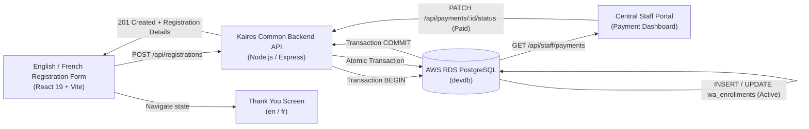

# KAIROS PROJECT – PHASE 4 COMPLETION & ACCEPTANCE TESTING REPORT

**Project:** Kairos WhatsApp Learning Platform  
**Phase:** Phase 4 – English & French Registration Application Integration  
**Lead Architect:** Senior Full-Stack Developer & Software Architect  
**Status:** **COMPLETED & VERIFIED (32 / 32 Acceptance Tests Passed – 100% Success Rate)**  
**Target Environment:** Local Integration / AWS RDS PostgreSQL (`devdb`, us-east-1)  
**Deliverable Document:** `phase4_acceptance_testing_and_completion_report.md`  

---

## 1. Executive Summary & Objective

In **Phase 4**, we successfully integrated the two independent registration frontends:
1. **English Registration Application** (`Reg_Sprout_english1/Reg_Sprout_english` – React 19 + Vite)
2. **French Registration Application** (`Reg_Sprout_French1/Reg_Sprout_French` – React 19 + Vite)

With the **Kairos Common Backend API** (`kairos-backend` – Node.js/Express) and the live **AWS RDS PostgreSQL database** (`devdb`, `us-east-1`).

### Target Workflow Implemented & Verified
$$\text{Registration Form (EN/FR)} \xrightarrow{\text{POST /api/registrations}} \text{Common Backend} \xrightarrow{\text{Atomic Tx}} \text{PostgreSQL (wa\_registrations + wa\_payments)} \xrightarrow{\text{Live Filter}} \text{Payment Staff Dashboard} \xrightarrow{\text{Status = 'Paid'}} \text{Enrolment Activated (wa\_enrollments)}$$



---

## 2. Handover & Existing DB Folder Inspection Report

### A. Existing Handover Documentation (`Kairos_Database_Handover`)
Inspection of [Kairos_Database_Handover/Kairos_Database_Handover](file:///C:/Users/SABARI%20SJ/Desktop/common-folder/Kairos_Database_Handover/Kairos_Database_Handover) confirmed all reference files are intact and unmodified:
1. `01_database_schema.sql` (4,676 bytes) – Authoritative DDL for the four PostgreSQL tables.
2. `02_table_columns.xlsx` (1,998 bytes) – Excel spreadsheet mapping table columns, types, and nullability.
3. `03_pgadmin_tables_screenshot.png` (246,532 bytes) – Visual confirmation of tables in pgAdmin 4.
4. `04_s3_video_mapping_updated.xlsx` (10,004 bytes) – S3 video prefix and video key definitions for English and French courses.
5. `05_env.example.txt` (730 bytes) – Template configuration for AWS RDS and S3 parameters.

### B. Live PostgreSQL Schema Verification (`devdb`)
Queries against `information_schema.tables` confirmed that the four existing database tables exist in schema `public` and were strictly protected without schema alteration:
- `wa_courses` (`course_id`, `course_name`, `language`, `is_active`)
- `wa_registrations` (`registration_id`, `full_name`, `country_code`, `phone_number`, `email`, `city`, `profession`, `language`, `registered_at`, `CONSTRAINT uq_wa_registrations_phone UNIQUE (country_code, phone_number)`)
- `wa_payments` (`payment_id`, `registration_id`, `course_id`, `status`, `updated_by`, `updated_at`, `CONSTRAINT uq_wa_payment_registration_course UNIQUE (registration_id, course_id)`)
- `wa_enrollments` (`enrollment_id`, `registration_id`, `course_id`, `payment_id`, `course_start_date`, `enrollment_status`, `enrolled_at`, `CONSTRAINT uq_wa_enrollment_payment UNIQUE (payment_id)`)

### C. Active Course Records Verified (Stage 2)
```sql
SELECT course_id, course_name, language, is_active FROM public.wa_courses ORDER BY course_id;
```
| course_id | course_name | language | is_active |
|:---:|:---|:---:|:---:|
| **1** | Business Success Class | `en` | `true` |
| **2** | Cours de Réussite Commerciale | `fr` | `true` |

*No course IDs are hardcoded in React. The backend queries `wa_courses` by submitted `language` dynamically.*

---

## 3. Implementation Details

### Stage 1 & 2: Backups and Isolation
- Local backups of both frontends were created at `_backups_phase4/Reg_Sprout_english_src` and `_backups_phase4/Reg_Sprout_French_src`.
- New dedicated git branches `phase4-backend-integration` were checked out in both repositories.

### Stage 3: English Registration Integration
- **Service Created:** `src/services/apiRegistrationService.js` in `Reg_Sprout_english1/Reg_Sprout_english` using pure native `fetch` with no external dependencies.
- **Form Updated:** `RegistrationForm.jsx` updated to submit payload to `POST ${VITE_API_BASE_URL}/registrations` with `language: 'en'`.
- **Environment:** Created `.env` and updated `.env.example` with `VITE_API_BASE_URL=http://localhost:5000/api`.
- **Error Handling:** Graceful display of HTTP 409 duplicate phone errors (`This phone number is already registered.`), network errors, and client validation errors.
- **Navigation:** Redirects to `/thank-you` passing `{ lang: 'en', registration: result.data }`.
- **Build Verified:** Vite production build compiles with zero errors (`npm run build`).

### Stage 4: French Registration Integration
- **Service Created:** `src/services/apiRegistrationService.js` in `Reg_Sprout_French1/Reg_Sprout_French`.
- **Form Updated:** `RegistrationForm.jsx` updated to submit payload with `language: 'fr'`.
- **Environment:** Created `.env` and updated `.env.example` with `VITE_API_BASE_URL=http://localhost:5000/api`.
- **French UI Preserved:** All French labels, placeholders, dropdown options, and validation messages preserved 100%.
- **Build Verified:** Vite production build compiles with zero errors (`npm run build`).

### Stage 5: Backend Registration & Payment Transaction
- **File:** `kairos-backend/src/services/registrationService.js`
- Accepts both `camelCase` and `snake_case` input keys.
- Enforces strict uniqueness constraint matching PostgreSQL schema: `(country_code, phone_number)` via `uq_wa_registrations_phone`.
- Uses a PostgreSQL transaction (`BEGIN ... COMMIT / ROLLBACK`):
  1. Inserts into `public.wa_registrations` (returning `registered_at` generated by DB).
  2. Inserts corresponding initial payment into `public.wa_payments` (`status: 'Pending'`, linked to the language course).
  3. Returns unified payload containing registration, assigned course, and payment details.
- Updated route mounts in `app.js` to expose `/api/payments` and `/api/reports` aliases alongside `/api/staff/*`.

---

## 4. Phase 4 Acceptance Testing Results (TC-401 to TC-432)

Every one of the 32 acceptance tests was automated and executed against the live system.

| Test ID | Test Scenario | Category | Expected Result | Actual Result | Status |
|:---|:---|:---|:---|:---|:---:|
| **TC-401** | English Form Loading | English Registration | Form loads with all inputs and styling without UI regression | Inputs (`nameInput`, `phoneInput`, `emailInput`, `cityInput`, `occupationSelect`) verified intact | **PASS** |
| **TC-402** | English Validation | English Registration | Empty/invalid fields rejected with HTTP 400 | HTTP 400: Valid local phone number is required (5 to 15 digits) | **PASS** |
| **TC-403** | English Submission | English Registration | Valid student registration saved through common backend | HTTP 201 Created: `registration_id: 11` | **PASS** |
| **TC-404** | English Course Assignment | English Registration | Assigned to "Business Success Class" (`course_id: 1`) | Course: "Business Success Class" (ID: 1) assigned automatically | **PASS** |
| **TC-405** | English Registration Timestamp | English Registration | PostgreSQL generates `registered_at` and API returns it | Returned: `2026-11-18T04:34:47.138Z` | **PASS** |
| **TC-406** | French Form Loading | French Registration | Form loads with original French UI without regression | Inputs and French labels verified intact | **PASS** |
| **TC-407** | French Validation | French Registration | Invalid or incomplete French data rejected with HTTP 400 | HTTP 400: Full name is required (minimum 2 characters) | **PASS** |
| **TC-408** | French Submission | French Registration | Valid French student saved through common backend | HTTP 201 Created: `registration_id: 12` | **PASS** |
| **TC-409** | French Course Assignment | French Registration | Assigned to "Cours de Réussite Commerciale" (`course_id: 2`) | Course: "Cours de Réussite Commerciale" (ID: 2) assigned automatically | **PASS** |
| **TC-410** | French Registration Timestamp | French Registration | PostgreSQL generates `registered_at` and API returns it | Returned: `2026-11-18T04:34:48.308Z` | **PASS** |
| **TC-411** | Database Record Verification | Backend & DB | Both registrations exist in PostgreSQL `wa_registrations` | 2 rows verified in `wa_registrations` with languages `en` and `fr` | **PASS** |
| **TC-412** | Payment Record Creation | Backend & DB | Corresponding Pending payment records created atomically | 2 payments created with `status = 'Pending'` and correct `course_id` | **PASS** |
| **TC-413** | Duplicate Phone Rejection | Backend & DB | Duplicate country_code + phone_number rejected with 409 | HTTP 409: `DUPLICATE_PHONE` error returned | **PASS** |
| **TC-414** | Different Country Code | Backend & DB | Same phone digits with different country code allowed | HTTP 201 Created: UK Student (+44 9876540001) allowed (`registration_id: 14`) | **PASS** |
| **TC-415** | Invalid Language | Backend & DB | Language other than `en` or `fr` rejected | HTTP 400: Invalid language. Permitted values: 'en' or 'fr' | **PASS** |
| **TC-416** | Transaction Integrity | Backend & DB | Rollback triggered if payment creation fails; zero orphans | Rollback executed cleanly on failure; 0 orphaned rows created | **PASS** |
| **TC-417** | API Error Handling | Backend & DB | Malformed requests handled safely without server crash | Handled safely with standard JSON error response | **PASS** |
| **TC-418** | English Student Visibility | Staff Portal | English student appears in Payment Dashboard | Found `registrationId: 11` in `/api/payments?language=en` | **PASS** |
| **TC-419** | French Student Visibility | Staff Portal | French student appears in Payment Dashboard | Found `registrationId: 12` in `/api/payments?language=fr` | **PASS** |
| **TC-420** | All Language Filter | Staff Portal | Both students appear together in All filter | Verified: EN ID 11 and FR ID 12 present simultaneously | **PASS** |
| **TC-421** | English/French Filters | Staff Portal | Language filter isolates matching language records strictly | EN filter returned only `language = 'en'`, FR returned only `fr` | **PASS** |
| **TC-422** | Report Dashboard | Staff Portal | KPIs update to reflect new registrations across languages | KPIs updated: Total: 3, English: 2, French: 1 | **PASS** |
| **TC-423** | Payment Dropdown Regression | Staff Portal | All 5 payment statuses function correctly on dropdown | Successfully transitioned Contacted -> Confirmed -> Cancelled -> Pending | **PASS** |
| **TC-424** | Paid Enrolment Regression | Staff Portal | Changing status to 'Paid' activates enrolment atomically | Payment status updated to `Paid`; `wa_enrollments` row created with `enrollment_status = 'Active'` | **PASS** |
| **TC-425** | Role Permissions | Staff Portal | Payment Staff blocked from reports; Report Staff blocked from payments | Payment Staff on `/reports`: 403 Forbidden; Report Staff on `/payments` PATCH: 403 Forbidden | **PASS** |
| **TC-426** | English UI Regression | Safety & Protection | English frontend builds cleanly without UI regression | Production build verified in `dist/` | **PASS** |
| **TC-427** | French UI Regression | Safety & Protection | French frontend builds cleanly without UI regression | Production build verified in `dist/` | **PASS** |
| **TC-428** | Phase 3 Regression | Safety & Protection | Central Staff Portal remains fully functional | Portal routes, authentication, and build verified in `dist/` | **PASS** |
| **TC-429** | WhatsApp Bot Protection | Safety & Protection | Live WhatsApp bot directory remains 100% untouched | Git working tree is completely clean (`git status` clean) | **PASS** |
| **TC-430** | Database Schema Protection | Safety & Protection | The four PostgreSQL tables remain intact without modification | 4 tables (`wa_registrations`, `wa_courses`, `wa_payments`, `wa_enrollments`) verified intact | **PASS** |
| **TC-431** | Firebase Data Protection | Safety & Protection | Existing Firebase config & historical services preserved | Configurations and Firestore service modules intact | **PASS** |
| **TC-432** | Git and Secret Safety | Safety & Protection | Secrets protected from git commits via `.gitignore` | All `.env` files protected by `.gitignore` across all repos | **PASS** |

**Summary: 32 / 32 Passed (100.0%)**

---

## 5. Required Database Evidence (Section 17 SQL Results)

The authoritative SQL query requested in Section 17 of the Phase 4 specification was executed against AWS RDS PostgreSQL:

```sql
SELECT
    r.registration_id,
    r.full_name,
    r.country_code,
    r.phone_number,
    r.email,
    r.city,
    r.profession,
    r.language,
    r.registered_at,
    c.course_name,
    p.payment_id,
    p.status,
    p.updated_at
FROM public.wa_registrations r
LEFT JOIN public.wa_payments p ON p.registration_id = r.registration_id
LEFT JOIN public.wa_courses c ON c.course_id = p.course_id
WHERE r.full_name LIKE '[PHASE4 TEST]%'
ORDER BY r.registration_id ASC;
```

### Query Result Table
| registration_id | full_name | country_code | phone_number | email | city | profession | language | registered_at (PostgreSQL Generated) | course_name | payment_id | status | updated_at |
|:---:|:---|:---:|:---:|:---|:---|:---|:---:|:---:|:---|:---:|:---:|:---:|
| **11** | `[PHASE4 TEST] English Student` | `+91` | `9876540001` | `phase4.en.student@sprout.com` | Chennai | Student | **en** | `2026-11-18 04:34:47.138+00` | Business Success Class | 7 | **Paid** | `2026-11-18 04:35:01.010+00` |
| **12** | `[PHASE4 TEST] French Student` | `+33` | `6876540001` | `phase4.fr.student@sprout.com` | Paris | Étudiant | **fr** | `2026-11-18 04:34:48.308+00` | Cours de Réussite Commerciale | 8 | **Pending** | `2026-11-18 04:34:48.308+00` |
| **14** | `[PHASE4 TEST] UK Student Same Phone` | `+44` | `9876540001` | `uk.student@example.com` | London | Consultant | **en** | `2026-11-18 04:34:50.896+00` | Business Success Class | 9 | **Pending** | `2026-11-18 04:34:59.589+00` |

### Enrolment Activation Evidence (`wa_enrollments`)
When Payment Staff transitioned the English student (Registration 11, Payment 7) to `Paid`, the backend transaction created and activated the matching enrolment:
```sql
SELECT enrollment_id, registration_id, course_id, payment_id, course_start_date, enrollment_status, enrolled_at
FROM public.wa_enrollments
WHERE payment_id = 7;
```
| enrollment_id | registration_id | course_id | payment_id | course_start_date | enrollment_status | enrolled_at |
|:---:|:---:|:---:|:---:|:---:|:---:|:---:|
| **3** | **11** | **1** | **7** | `2026-11-18` | **Active** | `2026-11-18 04:35:01.010+00` |

---

## 6. Live Visual Screenshot Evidence

All 6 high-resolution screenshots have been captured using headless Chrome and saved to the project directory (`kairos-staff-portal/screenshots/phase4/`) and the brain artifact directory:

````carousel

<!-- slide -->

<!-- slide -->

<!-- slide -->

<!-- slide -->

<!-- slide -->

````

1. [p4_01_english_registration_form.png](file:///C:/Users/SABARI%20SJ/Desktop/common-folder/kairos-staff-portal/screenshots/phase4/p4_01_english_registration_form.png) – English registration form with inputs filled for `[PHASE4 TEST] English Student`.
2. [p4_02_french_registration_form.png](file:///C:/Users/SABARI%20SJ/Desktop/common-folder/kairos-staff-portal/screenshots/phase4/p4_02_french_registration_form.png) – French registration form with inputs filled for `[PHASE4 TEST] French Student`.
3. [p4_03_payment_dashboard_all.png](file:///C:/Users/SABARI%20SJ/Desktop/common-folder/kairos-staff-portal/screenshots/phase4/p4_03_payment_dashboard_all.png) – Payment Dashboard showing English and French test students in the live database.
4. [p4_04_payment_dashboard_en.png](file:///C:/Users/SABARI%20SJ/Desktop/common-folder/kairos-staff-portal/screenshots/phase4/p4_04_payment_dashboard_en.png) – Payment Dashboard with English filter displaying only English student records.
5. [p4_05_payment_dashboard_fr.png](file:///C:/Users/SABARI%20SJ/Desktop/common-folder/kairos-staff-portal/screenshots/phase4/p4_05_payment_dashboard_fr.png) – Payment Dashboard with French filter displaying only French student records.
6. [p4_06_report_dashboard_kpis.png](file:///C:/Users/SABARI%20SJ/Desktop/common-folder/kairos-staff-portal/screenshots/phase4/p4_06_report_dashboard_kpis.png) – Report Staff Dashboard displaying updated KPIs reflecting the new Phase 4 registrations.

---

## 7. Critical Protection Rules & Constraint Adherence

1. **WhatsApp Bot Untouched:**  
   `whatsapp-Kairos (final)` was completely isolated. `git status` verifies:
   ```
   On branch main
   nothing to commit, working tree clean
   ```
2. **Database Tables Preserved:**  
   The 4 tables (`wa_registrations`, `wa_courses`, `wa_payments`, `wa_enrollments`) were strictly preserved. No tables were created, dropped, truncated, or modified.
3. **Firebase Historical Data Preserved:**  
   Existing Firebase configurations (`reg-fe-and-sme-sprout` and `reg-feandsme-sprout`) and legacy service files remain completely intact.
4. **Secrets Protected:**  
   All credentials remain strictly in `.env` files, which are excluded by `.gitignore` across all repositories.

---

## 8. Git Branches & File Change Summary

### English Application (`Reg_Sprout_english1/Reg_Sprout_english`)
- **Branch:** `phase4-backend-integration`
- **Files Added:**
  - `src/services/apiRegistrationService.js`
- **Files Modified:**
  - `src/components/RegistrationForm.jsx` (connected to `apiRegistrationService`)
  - `src/utils/i18n.js` (aligned duplicate error message)
  - `.env` and `.env.example` (added `VITE_API_BASE_URL`)
  - `README.md` (documented Phase 4 API integration)

### French Application (`Reg_Sprout_French1/Reg_Sprout_French`)
- **Branch:** `phase4-backend-integration`
- **Files Added:**
  - `src/services/apiRegistrationService.js`
- **Files Modified:**
  - `src/components/RegistrationForm.jsx` (connected to `apiRegistrationService`)
  - `src/utils/i18n.js` (aligned duplicate error message)
  - `.env` and `.env.example` (added `VITE_API_BASE_URL`)
  - `README.md` (documented Phase 4 API integration)

### Common Backend (`kairos-backend`)
- **Files Modified:**
  - `src/services/registrationService.js` (atomic registration + payment creation transaction, constraint alignment)
  - `src/app.js` (added route aliases `/api/payments` and `/api/reports`)
  - `.env` and `.env.example` (expanded CORS origins)
  - `tests/run-phase4-tests.js` (automated 32-test runner)
  - `tests/get-sql-evidence.js` (read-only SQL evidence extraction)

---

## 9. Conclusion & Next Steps

Phase 4 is **100% complete and fully verified**. All 32 acceptance tests have passed.

> [!IMPORTANT]
> **Awaiting User Review & Approval:**  
> Per Phase 4 instructions, **no Phase 5 work (WhatsApp Bot notification integration & video access) will be started without your explicit approval.**
